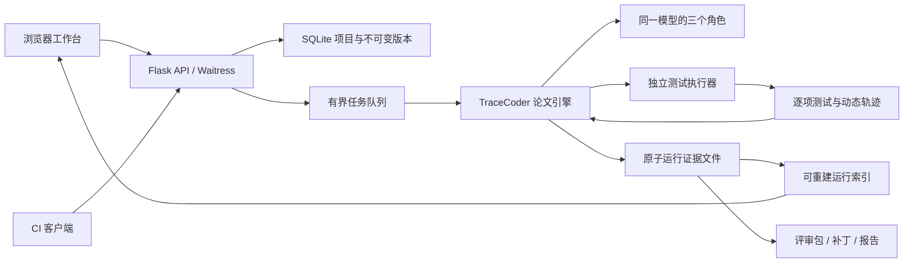

# 系统结构与扩展边界

TraceCoder 2.1 的工程层提供项目、执行、证据与部署管理。核心修复算法仍位于 `tracecoder/engine.py` 与 `policy.py`，新增系统功能不替代或旁路论文流程。

## 数据与状态

项目包含名称、说明和来源标识；来源标识只是元数据，服务不自动拉取 Git 仓库。每个任务拥有多次不可变 revision，字段包括需求、源码、测试、入口、起始方式与来源版本；生成任务的初始源码为空，由 generation 阶段生成并单独记录哈希。事务在分配 revision 时加写锁，内容用确定性 JSON 的 SHA-256 标识。

提交运行引用一个明确版本。`Run` 自身复制完整任务内容，并保存测试、题面、初始/最优代码哈希和核心模块哈希。后续更改项目任务不影响正在执行或历史运行。

运行 JSON 是完整证据，SQLite 保存用于列表、搜索和总览的摘要。每次阶段更新先用临时文件原子替换 `run.json`，再更新索引。启动时重建索引，标记未完成任务为中断。工作进程只保留正在执行或排队的对象，结束后释放内存对象，历史从持久化文件读取。

## 论文流程

每个任务单独维护 HLLM，不跨项目检索失败记录。插桩仅新增打印，验证 AST 与逐项测试状态保持；分析收到真实轨迹和全部同任务失败候选；修复作用于未插桩源代码。固定测试验证后按 Algorithm 2 决定接受、继续或回滚，最终输出历史最优代码。

新增队列、版本、报告、访问保护与运行对照属于工程层。它们不计为论文性能贡献。预设模式只替换智能体响应来源，运行测试、HLLM 和回滚仍走相同引擎。

## 执行隔离与接口

服务进程负责模型调用，执行器负责测试。实时模式仅允许 Docker；候选容器不接收服务认证头或模型密钥。参考解存在规范化数据中用于来源与执行器兼容检查，但 `catalog.get_task` 不把参考解放进模型任务对象。

固定演示通过可审阅的可信源码在受限子进程执行；这个后端不作为任意代码的安全沙箱。真实项目在保存阶段只做 AST 静态检查，不执行导入的顶层代码。

## 评审与工程交接

评审包记录输入、最优候选、固定测试、差异、各轮诊断/轨迹/调用与终止原因。补丁文件名使用明确的占位路径，应用前由原工程维护者核对。系统不直接更改项目仓库或发布生产代码。

CI 客户端只做输入准备、提交、轮询、结果下载。`--prepare-only` 路径无需配置模型，可验证应用接入；实际修复路径需服务端模型和执行镜像就绪。

## 后续应用扩展

| 目标 | 当前具备 | 仍需新增并验证 |
| --- | --- | --- |
| 团队业务函数修复 | 版本化输入、固定测试、隔离执行、评审包 | 在团队真实任务上测量效果、延迟、费用与误修复 |
| CI 辅助修复 | API、客户端、退出码、产物回收 | 按具体 CI 平台配置凭据/权限与人工评审关卡 |
| 多文件项目 | 单文件任务抽取入口 | 固定仓库快照、构建器、测试适配、路径权限、变更范围控制 |
| 大规模共享服务 | 单实例有界队列和持久化 | 身份认证、角色权限、租户隔离、分布式队列、隔离执行节点 |
| 论文指标复现 | 方法、原数据转换、可审计调用记录 | 固定模型、全量预算、基线、完整依赖环境和实验统计 |

这些是明确的扩展点，不是已交付能力或已完成实验。

## 官方入口与统一服务

`web_demo/app.py` 保留官方 `/generate`、`/history`、`/examples`、`/settings`、`/help` 及生成/停止/状态 API 路径，扩展项目与部署页面。页面共用 Jinja 外壳和本地静态资源，不依赖外部 CDN。`tracecoder/service.py` 管理独立的 Run、队列与索引；不再使用跨请求共享的模型客户端配置或全局停止标记。

模型 transport 只读取进程环境。`official_prompts.py` 三个构造函数正文来自 main，HLLM 格式器替换为全历史 JSON；`providers.build_messages` 是请求记录和真实 transport 的共同入口，避免展示提示与实际发送内容不一致。
